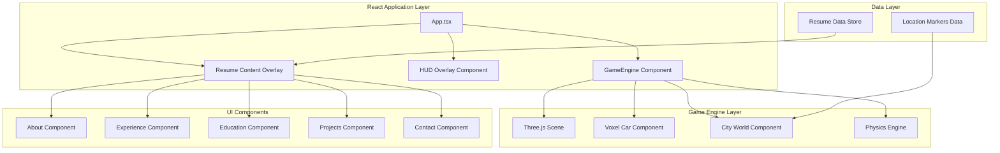
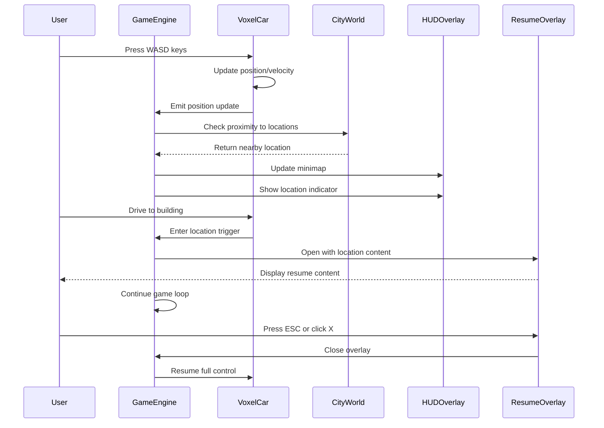

# 3D Voxel Car Racing Portfolio - Architecture Design

## Overview

A fully functional 3D voxel car racing game built with React.js and Three.js that serves as an interactive portfolio website. Users drive a voxel car through a vibrant, stylized city environment to discover resume content located at various buildings.

## System Architecture



## Component Architecture

### 1. Game Engine Component (`src/game/GameEngine.tsx`)

**Purpose**: Core Three.js scene management and game loop

**Responsibilities**:
- Initialize Three.js canvas with React Three Fiber
- Manage scene, camera, and renderer
- Handle game loop and animation frames
- Coordinate between game world and UI overlays
- Manage game state (playing, paused, viewing content)

**Key Props**:
```typescript
interface GameEngineProps {
  onLocationEnter: (locationId: string) => void;
  onLocationExit: () => void;
  isOverlayOpen: boolean;
}
```

### 2. Voxel Car Component (`src/game/vehicles/VoxelCar.tsx`)

**Purpose**: Player-controlled voxel car with physics

**Responsibilities**:
- Render voxel-based car model
- Handle keyboard input (WASD/Arrow keys)
- Implement car physics (acceleration, braking, steering)
- Handle collision detection with world objects
- Emit position updates to parent components

**Controls**:
- W/Up Arrow: Accelerate
- S/Down Arrow: Brake/Reverse
- A/Left Arrow: Turn Left
- D/Right Arrow: Turn Right
- Space: Handbrake

### 3. City World Component (`src/game/world/CityWorld.tsx`)

**Purpose**: Procedurally generated voxel city environment

**Responsibilities**:
- Generate voxel buildings and roads
- Place location markers for resume sections
- Manage static geometry for performance
- Handle ground plane and boundaries

**City Layout**:
```
┌─────────────────────────────────────────────────────┐
│                                                     │
│   ┌─────┐    ┌─────┐    ┌─────┐    ┌─────┐         │
│   │ABOUT│    │EXP  │    │EDU  │    │PROJ │         │
│   └─────┘    └─────┘    └─────┘    └─────┘         │
│                                                     │
│              ┌─────────┐                           │
│              │ CONTACT │                           │
│              └─────────┘                           │
│                                                     │
│   ═══════════════════════════════════════════════  │
│   ═══════════════════════════════════════════════  │
│   ═══════════════════════════════════════════════  │
│                                                     │
└─────────────────────────────────────────────────────┘
```

### 4. Location Marker Component (`src/game/world/LocationMarker.tsx`)

**Purpose**: Visual indicators for resume section locations

**Responsibilities**:
- Render 3D marker above buildings
- Display location name in floating text
- Handle proximity detection
- Trigger content overlay when player approaches

**Location Data Structure**:
```typescript
interface Location {
  id: string;
  name: string;
  position: [number, number, number];
  component: React.ComponentType;
  color: string;
  icon: string;
}
```

### 5. HUD Overlay Component (`src/game/ui/HUDOverlay.tsx`)

**Purpose**: Persistent heads-up display for game controls

**Responsibilities**:
- Display minimap with player position
- Show current speed and controls
- Display nearby location indicators
- Show navigation hints
- Toggle button for resume menu

**HUD Layout**:
```
┌─────────────────────────────────────────────────────┐
│  🚗 SPEED: 45 km/h    [📍]    [📋 MENU]             │
│                                                     │
│                                                     │
│                                                     │
│                                                     │
│                                                     │
│                                                     │
│                                                     │
│                                                     │
│                                                     │
│                                                     │
│                                                     │
│                                                     │
│                                                     │
│                                                     │
│                                                     │
│                                                     │
│  ┌─────────────────────────────────────────────┐   │
│  │              MINIMAP                         │   │
│  │  ┌─────┐    ┌─────┐    ┌─────┐    ┌─────┐  │   │
│  │  │ABOUT│    │EXP  │    │EDU  │    │PROJ │  │   │
│  │  └─────┘    └─────┘    └─────┘    └─────┘  │   │
│  │              ┌─────────┐                   │   │
│  │              │ CONTACT │                   │   │
│  │              └─────────┘                   │   │
│  │              ● Player                       │   │
│  └─────────────────────────────────────────────┘   │
│                                                     │
│  Controls: WASD to drive | Space to brake          │
└─────────────────────────────────────────────────────┘
```

### 6. Resume Content Overlay (`src/game/ui/ResumeOverlay.tsx`)

**Purpose**: Modal overlay for displaying resume content

**Responsibilities**:
- Display resume component when location is entered
- Maintain readability with semi-transparent background
- Allow closing to return to gameplay
- Keep game running in background

**Features**:
- Semi-transparent dark overlay
- Scrollable content area
- Close button (X) and ESC key support
- Backdrop blur effect
- Responsive design

### 7. Resume Data Store (`src/data/resumeData.ts`)

**Purpose**: Centralized data for all resume sections

**Responsibilities**:
- Export all resume data in structured format
- Maintain separation between data and presentation
- Enable easy updates to resume content

## Directory Structure

```
src/
├── App.tsx                          # Main app entry point
├── main.tsx                         # React entry point
├── components/                      # Existing resume components (unchanged)
│   ├── About.tsx
│   ├── Experience.tsx
│   ├── Education.tsx
│   ├── Projects.tsx
│   └── Contact.tsx
├── game/                            # New game directory
│   ├── GameEngine.tsx              # Main game component
│   ├── types/
│   │   └── game.ts                 # TypeScript interfaces
│   ├── vehicles/
│   │   ├── VoxelCar.tsx            # Car component
│   │   └── CarPhysics.ts           # Physics logic
│   ├── world/
│   │   ├── CityWorld.tsx           # City generation
│   │   ├── LocationMarker.tsx      # Location markers
│   │   ├── VoxelBuilding.tsx       # Building component
│   │   └── Road.tsx                # Road component
│   ├── ui/
│   │   ├── HUDOverlay.tsx          # Heads-up display
│   │   ├── ResumeOverlay.tsx       # Content overlay
│   │   ├── Minimap.tsx             # Minimap component
│   │   └── ControlsHelp.tsx        # Controls display
│   ├── hooks/
│   │   ├── useCarControls.ts       # Input handling
│   │   ├── useGameState.ts         # Game state management
│   │   └── useProximity.ts         # Proximity detection
│   └── utils/
│       ├── voxelGenerator.ts       # Voxel generation utilities
│       └── constants.ts             # Game constants
├── data/
│   └── resumeData.ts               # Resume data exports
└── context/
    └── ThemeContext.tsx            # Existing theme context
```

## Data Flow



## Technology Stack

### Core Dependencies
- **React 18.3.1** - UI framework
- **Three.js** - 3D rendering engine
- **@react-three/fiber** - React renderer for Three.js
- **@react-three/drei** - Useful helpers for R3F
- **@react-three/cannon** - Physics engine (optional, for realistic physics)

### Existing Dependencies (Preserved)
- **Tailwind CSS** - Styling
- **Lucide React** - Icons
- **@emailjs/browser** - Contact form functionality

## Key Design Decisions

### 1. Separation of Concerns
- Game Engine handles all 3D rendering and game logic
- UI Overlay components are pure React components
- Resume components remain unchanged and are simply rendered in the overlay

### 2. Performance Optimization
- Use instanced rendering for repeated voxel geometry
- Implement object pooling for particles
- Use React.memo for expensive components
- Lazy load resume content only when needed

### 3. Accessibility
- Keyboard-only navigation for the game
- High contrast UI elements
- Clear visual indicators for interactive elements
- ESC key to close overlays

### 4. Responsive Design
- Canvas resizes with window
- HUD adapts to different screen sizes
- Mobile-friendly controls (touch controls optional)

## Game Constants

```typescript
// src/game/utils/constants.ts
export const GAME_CONFIG = {
  // Car physics
  CAR: {
    MAX_SPEED: 50,
    ACCELERATION: 20,
    BRAKING: 30,
    TURN_SPEED: 2,
    FRICTION: 0.98,
  },
  // World settings
  WORLD: {
    SIZE: 200,
    BUILDING_COUNT: 20,
    ROAD_WIDTH: 10,
  },
  // Camera
  CAMERA: {
    DISTANCE: 15,
    HEIGHT: 8,
    SMOOTHING: 0.1,
  },
  // Interaction
  INTERACTION: {
    TRIGGER_DISTANCE: 8,
    INDICATOR_DISTANCE: 20,
  },
};
```

## Implementation Phases

### Phase 1: Foundation
1. Install dependencies
2. Set up project structure
3. Create basic Three.js scene
4. Implement simple voxel car

### Phase 2: World Building
1. Generate voxel city
2. Add roads and ground
3. Place location markers
4. Implement collision detection

### Phase 3: UI Integration
1. Create HUD overlay
2. Implement minimap
3. Add resume content overlay
4. Integrate existing resume components

### Phase 4: Polish
1. Add visual effects
2. Implement camera controls
3. Add loading screen
4. Optimize performance

### Phase 5: Testing & Deployment
1. Test all features
2. Fix bugs
3. Deploy to GitHub Pages
4. Verify functionality
